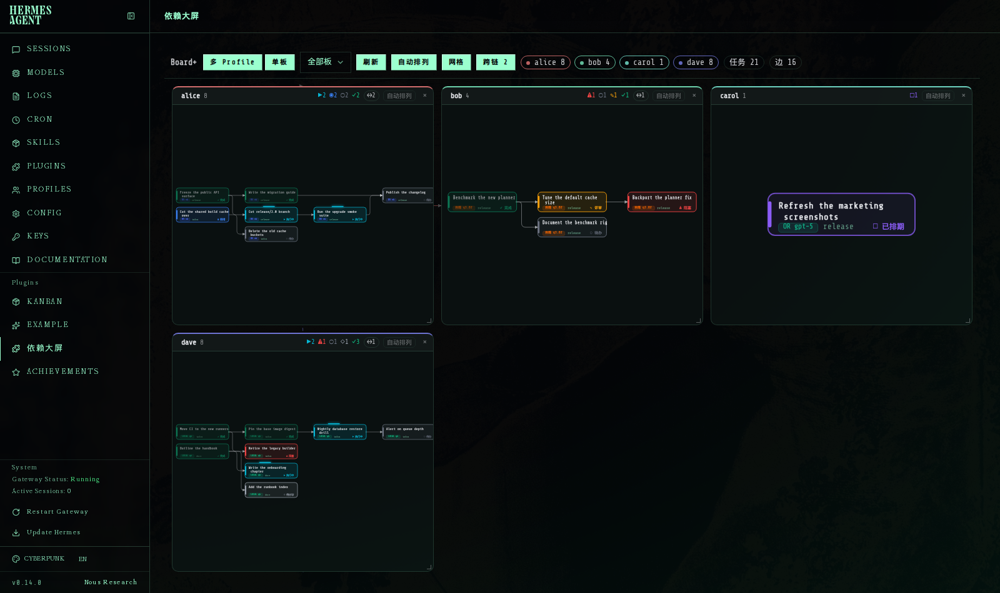
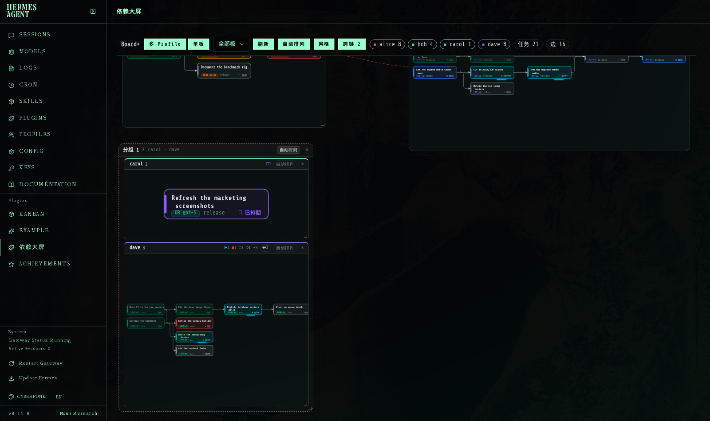
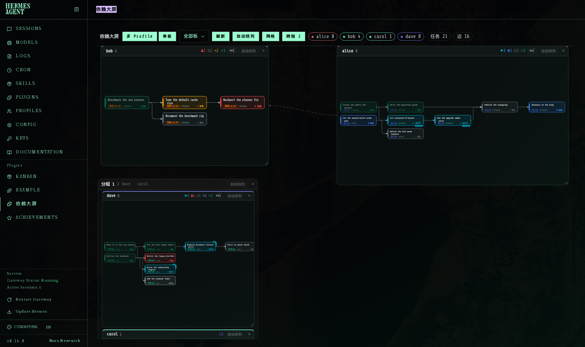
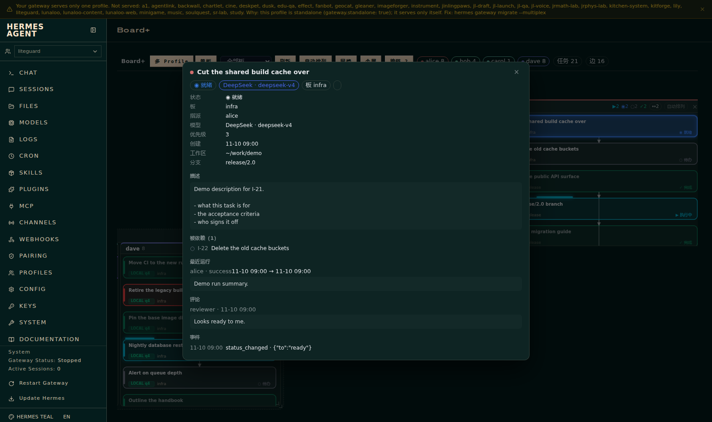
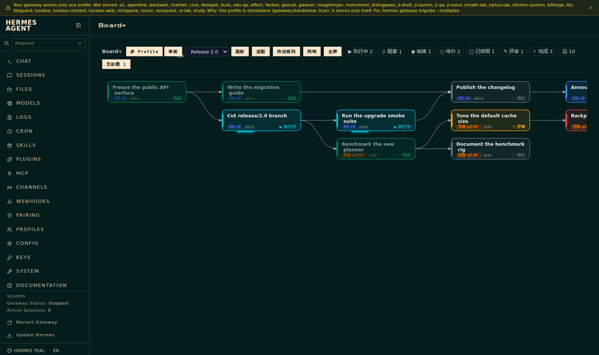

# hermes-kanban-graph — **Board+**

A dashboard plugin for **Hermes Agent**: every Kanban task as a block, every
`parent → child` dependency as a wire, one card per profile, all on a single
draggable wall.

插件名就叫 `Board+`（中英文都是它，左侧 tab 也是这个名字）。Hermes 的仪表盘插件：把 Kanban 任务画成方块、把 `父 → 子` 依赖画成连线，每个 profile 一张卡片，
全部铺在一面可拖动的大屏上。



---

## What it does · 功能

| | |
|---|---|
| **Dependency DAG** | Tasks are laid out on a lattice by topological depth; `parent → child` edges are drawn orthogonally, cycle-broken edges dashed. |
| **Multi-profile wall** 多 Profile 大屏 | One card per `assignee`. Drag, resize, magnet-snap to neighbours and to the 8 px lattice. Overlaps are resolved automatically (卡片互相排开). |
| **Card order** 卡片排序 | Cards that still draw task blocks come first, then by profile name (numeric suffixes compare numerically, unassigned last). Auto-arrange tiles in this order, so the busy profiles land top-left; a card whose blocks are all filtered out by the status legend sinks to the back. |
| **Auto-arrange engine** 自动排列 v11–v12 | Top-bar 自动排列 and the default layout: cards holding task blocks tile row-first (fill a row before wrapping) and their height auto-fits so the busy wall stays on one screen; collapsed empty cards gather into one compact shelf directly beneath, packed side-by-side at their own content width (row-first, no stretched gaps). |
| **Groups** 分组 | Drop a card onto another to form a group; members are tiled inside. Double-click the group title to rename in place. v12: groups NEST — drop a group's title bar onto another group (up to 4 levels, cycle-guarded; the store is always a legal forest); drag a nested group out of the body to extract it back to the wall; ✕ dissolves only the clicked level (children survive as top-level); empty group titles flow as compact strips inside the body, one per member group, draggable again. |
| **Content-aware layout** 按内容排布 | Members that hold task blocks get a bigger share of the group body, empty ones shrink. |
| **自动排列 per card** | A button on every card: put its task blocks back on the lattice, resize the card to its content, and (for a group) re-run the weighted layout. |
| **Dependency-aware packing** 依赖优先排布 | Inside a card, 自动排列 groups the tasks by their dependency chain: every CONNECTED chain gets its own contiguous run (a parent sits right above its child), so a wire never has to cross the blocks of an unrelated chain. |
| **Rubber-band select** 框选 | Drag on the empty canvas of a card to sweep a band over the task blocks: every block it touches is selected. Click a block to select it, shift-click to add. |
| **Group drag** 整体拖动 | Drag any selected block and the whole selection moves with it, rigidly (one write, one undo point). Click the empty canvas to drop the selection. |
| **Task detail popup** 任务详情 | Double-click any task block for status, assignee, model, timings, description, dependencies, recent runs, comments and events. |
| **Drag reference grid** 参考格子 | While you drag, an 8 px / 40 px grid appears so drops land tidy; toggle it off with 网格. |
| **Status filter** | Per-status chips hide whole statuses (persisted). |
| **Maximise** | Double-click a card's header to blow it up over the wall. |
| **Single-board view** 单板 | The full DAG for one board with pan / zoom / drag-to-place nodes. |

Everything lives in `localStorage`, nothing leaves your machine.
所有布局状态只写本机 `localStorage`，插件本身不联网。

---

## Install · 安装

Requirements: Hermes Agent with the dashboard (`hermes dashboard`), and the
`hermes_cli.kanban_db` module (ships with Hermes).

**Option 1 — let Hermes install it (default profile):**

```bash
hermes plugins install weifengchui/hermes-kanban-graph
```

One command: the repo is laid out exactly the way the plugin loader wants it
(`dashboard/manifest.json` + `dashboard/dist/` + `dashboard/plugin_api.py`),
so the clone lands as `~/.hermes/plugins/kanban-graph/dashboard/`.
`hermes plugins update kanban-graph` pulls later commits, `hermes plugins remove kanban-graph` uninstalls.

> **Enable it.** Newer Hermes builds list a dashboard tab only for plugins that
> are in `plugins.enabled` — an installed-but-not-enabled plugin is silently
> withheld from the tab bar (and its `api` is never imported). If Board+ is
> missing after an upgrade, run `hermes plugins enable kanban-graph` and
> restart the dashboard. Older builds that only honour
> `dashboard.hidden_plugins` are unaffected; enabling is safe on both.

**Full cross-machine playbook** (agent-facing skill, version-gated — enable
filter on newer builds, profile-shim workaround, isolated `HERMES_HOME`
launch, headless checks, why a fresh board is empty):
`skills/board-plus-install/SKILL.md`.

**Option 2 — `install.sh` (named profile / offline checkout):**

```bash
# from the repo root
./install.sh                 # -> ~/.hermes/plugins/kanban-graph/dashboard/
./install.sh liteguard       # -> ~/.hermes/profiles/liteguard/plugins/kanban-graph/dashboard/
HERMES_HOME=/x ./install.sh   # custom Hermes home
```

`install.sh` copies the four payload files from `dashboard/` into the target
profile, plus the root `plugin.yaml` (the CLI resolves the plugin *name* from
it — without it `hermes plugins enable kanban-graph` answers "No plugin named
'kanban-graph'"). Both options write the same layout.

Then enable it and restart the dashboard, so the Python API + the manifest
label are loaded:

```bash
hermes -p <profile> plugins enable kanban-graph   # named profile
hermes plugins enable kanban-graph                 # default profile
hermes dashboard --stop
hermes dashboard --no-open --port 9119
```

Open `http://127.0.0.1:9119/kanban-graph` (a **Board+** tab appears next to Kanban). The JS/CSS are read from disk on every request, so front-end edits only
need a browser reload — only `plugin_api.py` needs the restart.

Manual install is the same four files, no build step: the front-end is a plain
script (`window.__HERMES_PLUGINS__.register(...)`), no bundler, no npm.

### Repo layout · 仓库结构

```
hermes-kanban-graph/
├── plugin.yaml            # plugin manifest (name/version) — makes `hermes plugins install` name it kanban-graph
├── dashboard/             # ← the plugin payload, exactly what gets installed
│   ├── manifest.json      # tab config, icon, entry/css/api paths (relative to dashboard/)
│   ├── dist/index.js      # pre-built front-end bundle (IIFE, no bundler)
│   ├── dist/style.css
│   └── plugin_api.py      # FastAPI router → GET /api/plugins/kanban-graph/{boards,graph,task}
├── install.sh             # manual installer (copies dashboard/*)
├── tools/demo_shots.py    # regenerates screenshots/ against synthetic data
└── screenshots/
```

The `dashboard/` subdirectory is not cosmetic — the loader only discovers
`<plugin>/dashboard/manifest.json`, so a repo whose manifest sits at the root
clones successfully and then shows up nowhere.

---

## Interactions · 操作

| gesture | effect |
|---|---|
| drag a card header | move it (magnet to neighbours + 8 px grid) |
| drag the bottom-right grip | resize (bottom-right only; origin stays put) |
| drop a card onto another | form a group |
| drag a member inside a group | move it inside the card |
| drag a group's title bar onto another group | NEST it (v12; cycle-proof — nesting into your own descendant is refused) |
| drag a nested group out of its parent's body | extract it back to the wall as a top-level group |
| click ✕ on a group | dissolve ONE level — member profiles free, child groups survive as top-level cards |
| double-click a card header | maximise / restore |
| double-click a task block | task detail popup (`Esc` or the backdrop closes it) |
| double-click a group title | rename in place (`Enter` saves, `Esc` cancels) |
| drag a task block inside a card | rearrange that profile's blocks |
| drag on the empty canvas of a card | rubber-band select every task block the band touches |
| click a task block | select it (shift-click adds / removes) |
| drag a selected task block | move the WHOLE selection, rigidly |
| click the empty canvas of a card | drop the selection |
| click 自动排列 on a card | tidy that card (resize to its content / re-run the group layout / pack the dependency chains) |
| click 自动排列 in the toolbar | re-tile the whole wall, in card order (有任务块的在前，其后按名) |
| click 网格 | show/hide the drag reference grid |

---

## Screenshots

| | |
|---|---|
|  | grouped, weighted by content |
|  | reference grid while dragging |
|  | task detail popup |
|  | single-board DAG |

Regenerate them against **synthetic** data (no real board is read):

```bash
python tools/demo_shots.py        # needs the dashboard on :9119
```

---

## API

The plugin adds three read-only routes under
`/api/plugins/kanban-graph/` (registered by `plugin_api.py`):

| route | returns |
|---|---|
| `GET /boards` | `{current, boards:[{slug,title}]}` |
| `GET /graph?board=<slug>` | `{board, nodes, edges, back_edges}` — nodes carry `tag` / `tagFull` / `tagColor`, the provider · model chip derived from that profile's config |
| `GET /task?board=<slug>&id=<task>` | one task in full + parents/children/comments/events/runs |

All three open the board SQLite file read-only (`file:…?mode=ro`).

---

## Layout knobs

`dashboard/dist/index.js`, top of the file:

```js
var GRID = 8, SNAP = 8;                       // lattice + magnet tolerance
var PMIN_W = 240, PMIN_H = 150;               // a free card's minimums
var PDEF_W = 460, PDEF_H = 330;               // its "one unit of content" size
var GMIN_W = 320, GMIN_H = 230, GHEAD = 30;   // group card chrome
var IMIN_W = 180, IMIN_H = 108;               // an inner member's minimums
var PROF_W_EMPTY = 1, PROF_W_BUSY = 3;        // content weight: empty … busy
```

`PROF_W_EMPTY`/`PROF_W_BUSY` drive the content-aware group layout
(`profWeight` → `weightedSlots`, a squarified treemap).

---

## Tests

The acceptance harness lives outside this repo (it drives the live dashboard
with Playwright). The pure geometry is exposed on `window.__KG_TEST__` so it can
be unit-tested without a DOM:

```js
window.__KG_TEST__.snapMove / snapResize / innerLayout / weightedSlots /
profWeight / squarifyRects / tileRects / groupByProfile / buildPanels …
```

---

## License

MIT — see [LICENSE](LICENSE).
